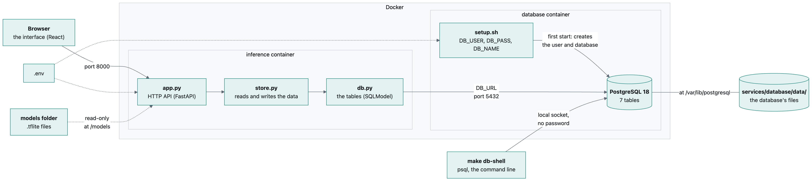
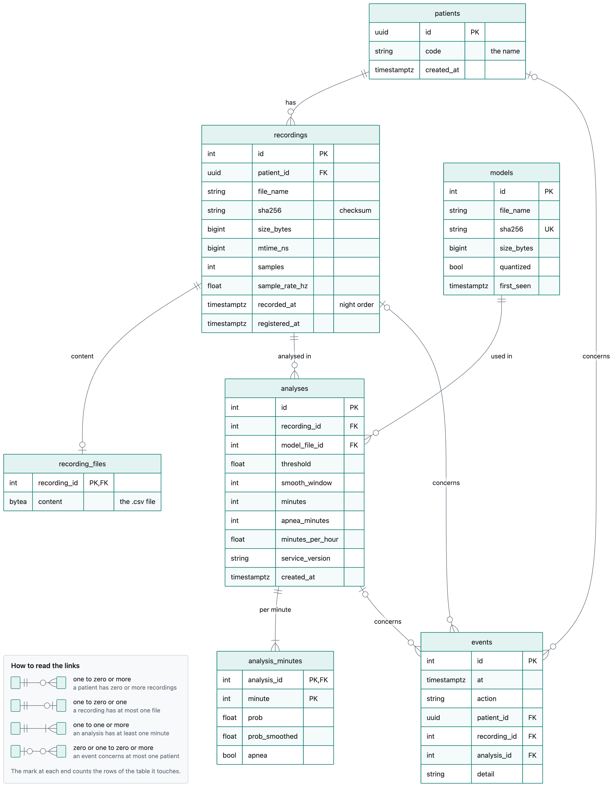
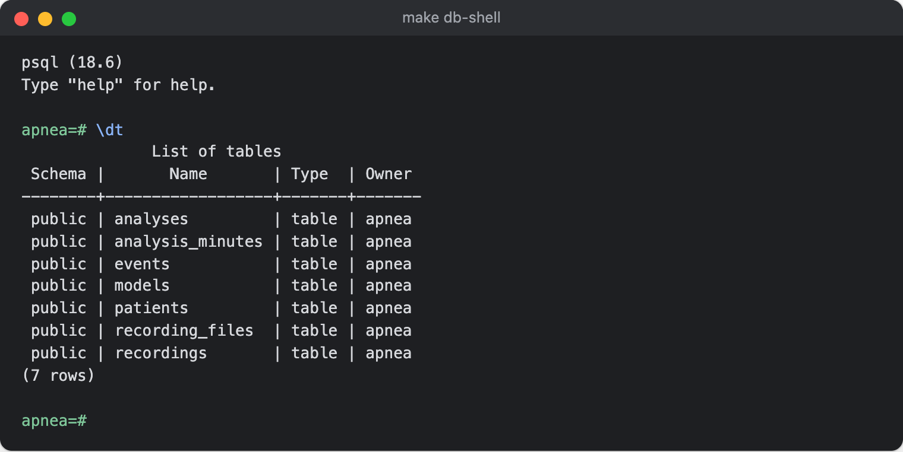
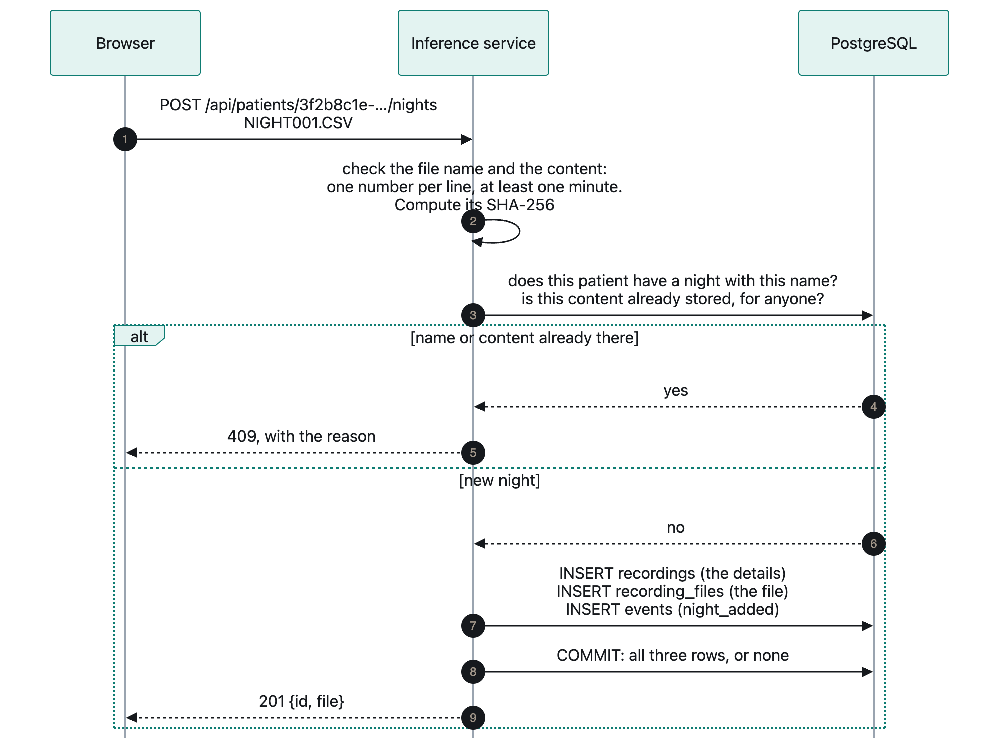
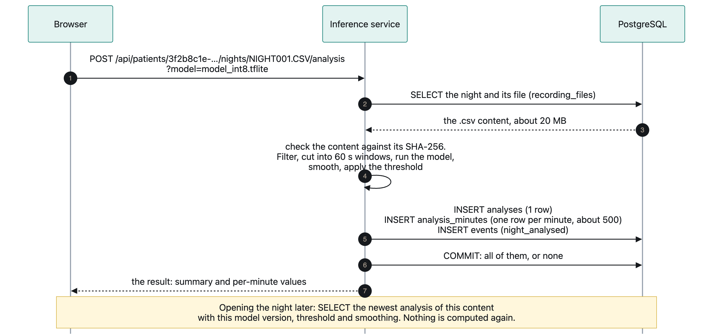
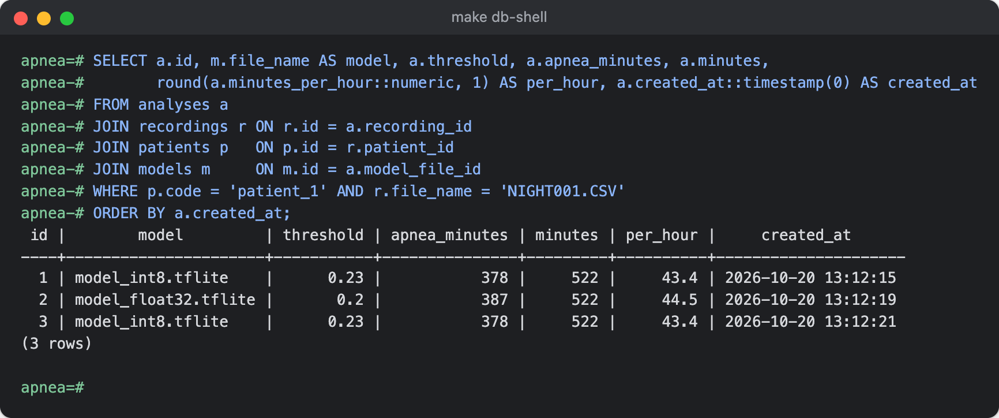
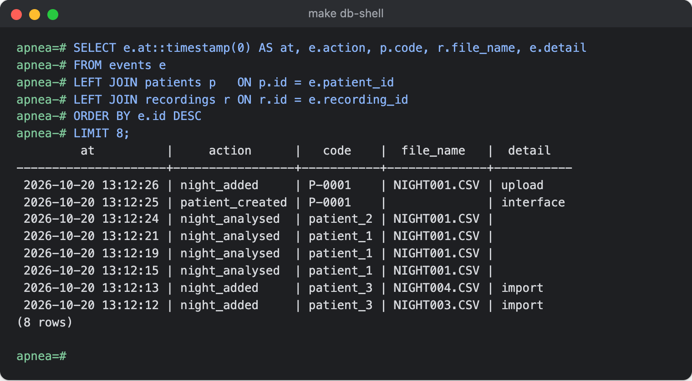

# The database

The inference service ([INFERENCE.md](INFERENCE.md)) keeps everything it knows in a **PostgreSQL
database**: the patients, their nights with the recordings themselves, every analysis with its
minute-by-minute values, the versions of the model files, and a log of what happened. This page
explains what is in it, how to look at it, and how to back it up, restore it or start again.

Nothing about patients is kept in files: a night's `.csv` file is stored in the database, byte for
byte, when it is uploaded. Only the model files stay on disk.

---

## Contents

1. [At a glance](#1-at-a-glance)
2. [Starting and stopping](#2-starting-and-stopping)
3. [Opening the database](#3-opening-the-database)
4. [The tables](#4-the-tables)
5. [How the service fills it](#5-how-the-service-fills-it)
6. [Questions you can ask](#6-questions-you-can-ask)
7. [Exporting to a CSV file](#7-exporting-to-a-csv-file)
8. [From Python](#8-from-python)
9. [With a desktop app](#9-with-a-desktop-app)
10. [Backup and restore](#10-backup-and-restore)
11. [Starting again from empty](#11-starting-again-from-empty)

---

## 1. At a glance

| | |
|---|---|
| Database | PostgreSQL 18, in the Docker container `apnea_database` (Compose service `database`), built from [services/database/Dockerfile](services/database/Dockerfile) |
| Its files | `services/database/data/` in the project, seen by the container as `/var/lib/postgresql`. Not committed to git |
| Reached by | The inference service only, at `database:5432` inside Docker. Not opened on the computer or the network |
| Settings | `DB_USER`, `DB_PASS`, `DB_NAME` and `DB_URL` in `.env` |
| Code | [services/inference/source/db.py](services/inference/source/db.py): the tables. [services/inference/source/store.py](services/inference/source/store.py): how the service reads and writes them |
| Command line | `make db-shell` |

Where the database sits: the browser talks only to the inference service, and the inference service
is the only program that connects to PostgreSQL. `make db-shell` opens it from inside its own
container.



The seven tables and how they point to each other. `PK` is a table's own id, `FK` a column that
points to another table's id, `UK` a column whose values are all different:



The box at the bottom left of the image explains the marks at the ends of the links.

The diagrams are drawn from the `.mmd` files next to them in [docs/diagrams/](docs/diagrams/). To
change one, paste its `.mmd` file into [mermaid.live](https://mermaid.live), edit it there and
export it as PNG over the old image. The legend at the bottom left of the tables image is not part
of its `.mmd` file: Mermaid has no legends, so an export from mermaid.live comes out without it.

---

## 2. Starting and stopping

The database starts and stops with the service:

| Command | What happens to the database |
|---|---|
| `make up` | Starts it first; the service starts once it reports `healthy` |
| `make ps` | Shows `apnea_database` and `apnea_inference`, both `(healthy)` when all is well |
| `make stop`, `make down` | Stops it. Nothing is lost |
| `make clean` | Removes the containers, Docker's volumes and caches. Nothing in `services/database/data/` is lost |

The first start creates the database, with the user, password and name set in `.env`. Every later
start reuses what is in `services/database/data/`.

The data is in a folder of the project, not in a Docker volume. Deleting the containers, the images
or Docker's volumes (`make down`, `make clean`, `docker compose down -v`, `docker volume prune`)
leaves it as it is; only deleting the folder deletes the database.

**Never edit or copy files inside `services/database/data/` while the database runs.** They are
PostgreSQL's own files. To save the data, use a [backup](#10-backup-and-restore).

---

## 3. Opening the database

With the service running, from the project folder:

```bash
make db-shell
```

This opens **psql**, PostgreSQL's command line, connected to the database. Type `\dt` to list the
tables:



| Type | To |
|---|---|
| `\dt` | List the tables |
| `\d recordings` | See a table's columns and their types |
| a query ending with `;` | Run it. A query can span several lines; it runs at the `;` |
| `\x` | Switch between table display and one-field-per-line display, handy for wide rows |
| `q` | Leave a long result (psql shows long results one page at a time) |
| `\q` | Quit psql |

Times are shown in UTC.

---

## 4. The tables

### patients

One row per patient.

| Column | Meaning |
|---|---|
| `id` | The patient's identifier: a random UUID, created with the patient. It ends the patient's page address |
| `code` | The patient's name. Several patients may share one: `id` tells them apart |
| `created_at` | When the patient was created |

### recordings

One row per night: the details of its file. The file itself is in `recording_files`.

| Column | Meaning |
|---|---|
| `id` | Number of the row |
| `patient_id` | The patient (`patients.id`) |
| `file_name` | The original file's name, for example `NIGHT001.CSV` |
| `sha256` | Checksum of the file's content: two nights with the same checksum are identical |
| `size_bytes` | Size of the file |
| `mtime_ns` | The original file's modification time, in nanoseconds since 1 January 1970 |
| `samples` | Number of ECG samples |
| `sample_rate_hz` | Sampling rate (`RECORDING_FS` when the night was added) |
| `recorded_at` | The same modification time, as a date. Sets the night order: the oldest is Night 1 |
| `registered_at` | When the night was added |

### recording_files

One row per night: its `.csv` file, byte for byte. A table of its own, so that listing nights never
reads the files (about 20 MB each; PostgreSQL stores them compressed, about a third of that).

| Column | Meaning |
|---|---|
| `recording_id` | The night (`recordings.id`) |
| `content` | The file's content |

### models

One row per version of a model file.

| Column | Meaning |
|---|---|
| `id` | Number of the row |
| `file_name` | The `.tflite` file's name |
| `sha256` | Checksum of the file. A new version of the same file gets a new row |
| `size_bytes` | Size of the file |
| `quantized` | `true` for an int8 model, `false` for float32 |
| `first_seen` | When this version was first used |

### analyses

One row per run of a model on a night. **Never changed once written.**

| Column | Meaning |
|---|---|
| `id` | Number of the row |
| `recording_id` | The night (`recordings.id`) |
| `model_file_id` | The model version (`models.id`) |
| `threshold` | Threshold used for the decision |
| `smooth_window` | Minutes averaged in the smoothing |
| `minutes` | Number of minutes analysed |
| `apnea_minutes` | Minutes flagged as apnea: **Apnea minutes** in the interface |
| `minutes_per_hour` | `apnea_minutes` divided by the hours analysed: **Minutes per hour** in the interface |
| `service_version` | Version of the service's code that produced it |
| `created_at` | When it ran |

### analysis_minutes

One row per minute of an analysis: what the night page's chart draws. About 500 rows per analysis.

| Column | Meaning |
|---|---|
| `analysis_id` | The analysis (`analyses.id`) |
| `minute` | 0 for the first minute of the night, 1 for the next... |
| `prob` | The model's apnea probability, from 0 to 1 |
| `prob_smoothed` | `prob` after the 5-minute average: the chart's green line |
| `apnea` | `true` when `prob_smoothed` is above the threshold: the chart's red strip |

### events

One row per action.

| Column | Meaning |
|---|---|
| `id` | Number of the row |
| `at` | When it happened |
| `action` | `patient_created`, `night_added` or `night_analysed`. Older rows may also hold `patient_registered`, `night_registered`, `night_replaced`, `night_removed` and `night_changed`, from the version that read nights from a folder, and `night_content_restored`, from a removed import command |
| `patient_id`, `recording_id`, `analysis_id` | What it concerns, when relevant |
| `detail` | Where a patient or night came from: `interface` (a created patient) or `upload` (an uploaded night). Older rows may hold `folder` or `import` |

---

## 5. How the service fills it

**Patients.** **Create patient** in the interface adds a row to `patients`. Several patients may
have the same name: the interface and the API identify a patient by its `id`, which is the number in
its page's address (`/patient/3f2b8c1e-5d4a-4e7b-9c2d-8a1f6e0b7d35`).

**Nights.** **Upload nights** in the interface adds a row to `recordings` and the file's content to
`recording_files`, together with an event, all saved together or not at all.
A night is refused when its name is already used by the same patient, or when the same content
(same `sha256`) is already stored for any patient. A night keeps the original file's modification
time, which sets its place in the order.



**Nights without content.** Before the recordings were kept in the database, nights were read from
a folder, and only their details were stored. Such a night is not shown. Uploading its file again
stores it as a new night, and its earlier analyses show again, since an analysis follows a night's
content (`sha256`).

**Analyses.** Each click on **Analyse** (or each night of **Analyse all nights**) adds one row to
`analyses`, about 500 rows to `analysis_minutes` and one to `events`, all saved together or not at
all. Before analysing, the service checks the stored content against its `sha256`.



**Which result the interface shows.** The newest analysis of the night's content (same `sha256`),
with the current version of the selected model file, the current threshold and smoothing. After a
new model file or a new threshold, the night shows "Not analysed" again; the older analyses stay in
the table.

**Nothing is deleted.** Old analyses stay, so the history is complete.

---

## 6. Questions you can ask

Paste these into `make db-shell`. Change the patient's code or the file name to your own.

**Each patient and its number of nights**

```sql
SELECT p.id, p.code, count(f.recording_id) AS nights
FROM patients p
LEFT JOIN recordings r      ON r.patient_id = p.id
LEFT JOIN recording_files f ON f.recording_id = r.id
GROUP BY p.id, p.code
ORDER BY p.code, p.created_at;
```

**A patient's nights, oldest first**

```sql
SELECT r.file_name, r.recorded_at::date AS recorded,
       round((r.samples / r.sample_rate_hz / 3600)::numeric, 1) AS hours
FROM recordings r
JOIN recording_files f ON f.recording_id = r.id
JOIN patients p        ON p.id = r.patient_id
WHERE p.code = 'patient_1'
ORDER BY r.recorded_at;
```

**Every analysis of one night**

```sql
SELECT a.id, m.file_name AS model, a.threshold, a.apnea_minutes, a.minutes,
       round(a.minutes_per_hour::numeric, 1) AS per_hour, a.created_at::timestamp(0) AS created_at
FROM analyses a
JOIN recordings r ON r.id = a.recording_id
JOIN patients p   ON p.id = r.patient_id
JOIN models m     ON m.id = a.model_file_id
WHERE p.code = 'patient_1' AND r.file_name = 'NIGHT001.CSV'
ORDER BY a.created_at;
```

Here Night 1 was analysed with int8, then float32, then int8 again; all three runs are kept:



**Every night above 30 apnea minutes per hour** (newest analysis of each night with each model)

```sql
SELECT * FROM (
  SELECT DISTINCT ON (a.recording_id, a.model_file_id)
         p.code, r.file_name, m.file_name AS model,
         round(a.minutes_per_hour::numeric, 1) AS per_hour
  FROM analyses a
  JOIN recordings r ON r.id = a.recording_id
  JOIN patients p   ON p.id = r.patient_id
  JOIN models m     ON m.id = a.model_file_id
  ORDER BY a.recording_id, a.model_file_id, a.created_at DESC
) newest
WHERE per_hour > 30
ORDER BY per_hour DESC;
```

**The first minutes of an analysis** (`analysis_id` from the query above it)

```sql
SELECT minute, prob, prob_smoothed, apnea
FROM analysis_minutes
WHERE analysis_id = 1
ORDER BY minute
LIMIT 8;
```

**What happened recently**

```sql
SELECT e.at::timestamp(0) AS at, e.action, p.code, r.file_name, e.detail
FROM events e
LEFT JOIN patients p   ON p.id = e.patient_id
LEFT JOIN recordings r ON r.id = e.recording_id
ORDER BY e.id DESC
LIMIT 8;
```



**Identical night files** (same content under two names)

```sql
SELECT left(r.sha256, 12) AS checksum, string_agg(p.code || '/' || r.file_name, ', ') AS files
FROM recordings r
JOIN recording_files f ON f.recording_id = r.id
JOIN patients p        ON p.id = r.patient_id
GROUP BY r.sha256
HAVING count(*) > 1;
```

**Size of the database, and of the stored files**

```sql
SELECT pg_size_pretty(pg_database_size(current_database())) AS database,
       pg_size_pretty(pg_total_relation_size('recording_files')) AS night_files;
```

---

## 7. Exporting to a CSV file

From the project folder, without opening psql. `--csv` writes the result as CSV, and `>` saves it
in a file on your computer:

```bash
docker compose exec -T database sh -c 'psql -U "$DB_USER" -d "$DB_NAME" --csv -c "SELECT code, created_at FROM patients ORDER BY code"' > patients.csv
```

```
code,created_at
P-0001,2026-10-15 16:29:39.832457+00
patient_1,2026-10-15 16:28:45.911057+00
...
```

Any query from [section 6](#6-questions-you-can-ask) works between the double quotes, as long as it
has no double quotes of its own.

---

## 8. From Python

The tables are Python classes in [services/inference/source/db.py](services/inference/source/db.py), and
[services/inference/source/store.py](services/inference/source/store.py) has the functions the service uses, so a
Python script can read the data without writing SQL. Run Python inside the service's container,
where the connection is already set up: `make shell`, then `python`.

```python
from sqlmodel import Session
import store
from db import engine

with Session(engine) as session:
    for patient in store.patients(session):
        nights = store.nights(session, patient)
        print(patient.code, len(nights), [n.file_name for n in nights])
```

```
P-0001 1 ['NIGHT001.CSV']
patient_1 3 ['NIGHT001.CSV', 'NIGHT002.CSV', 'NIGHT003.CSV']
patient_2 2 ['NIGHT001.CSV', 'NIGHT002.CSV']
patient_3 4 ['NIGHT001.CSV', 'NIGHT002.CSV', 'NIGHT003.CSV', 'NIGHT004.CSV']
```

`patient.recordings` follows the link from a patient to its nights; in the same way,
`recording.analyses`, `analysis.per_minute` and `analysis.model_file` follow the other links.
Only read this way: the service expects to be the only one writing.

**Getting a night's file back out.** From the project folder, this writes the `NIGHT001.CSV` of the
patient whose `id` is `3f2b8c1e-5d4a-4e7b-9c2d-8a1f6e0b7d35` to a file on your computer, identical to the one
that was uploaded. The `id` is the end of the patient's page address, or the first column of the
first query in [section 6](#6-questions-you-can-ask):

```bash
docker compose exec -T inference python -c '
import sys, store
from uuid import UUID
from db import engine
from sqlmodel import Session
with Session(engine) as s:
    patient = store.patient(s, UUID("3f2b8c1e-5d4a-4e7b-9c2d-8a1f6e0b7d35"))
    night = next(n for n in store.nights(s, patient) if n.file_name == "NIGHT001.CSV")
    sys.stdout.buffer.write(store.content(s, night))' > NIGHT001.CSV
```

---

## 9. With a desktop app

The database is not reachable from outside Docker. To open it in DBeaver, TablePlus, pgAdmin or a
VS Code extension, add a `ports` line to the `database` service in `docker-compose.yml`:

```yaml
  database:
    ...
    ports:
      - "127.0.0.1:5432:5432"
```

then run `make up`, and connect with:

| Setting | Value |
|---|---|
| Host | `localhost` |
| Port | `5432` (use `"127.0.0.1:5433:5432"` and `5433` if PostgreSQL is already installed on the computer) |
| User, password, database | `DB_USER`, `DB_PASS`, `DB_NAME` from `.env` |

`127.0.0.1` opens the port on this computer only, not on the network. Use the app to look, not to
edit: the service relies on analyses never being changed.

---

## 10. Backup and restore

The database holds everything, the recordings included, so a backup of the database is a backup of
all the patients' data.

**Back up** into one file, `backup.dump`, from the project folder:

```bash
docker compose exec -T database sh -c 'pg_dump -U "$DB_USER" -Fc "$DB_NAME"' > backup.dump
```

`-Fc` writes PostgreSQL's compressed format: about 4 MB per night of recording. (A plain `.sql`
backup would be about ten times larger, because it writes the files as text.)

**Restore** a backup, replacing everything currently in the database:

```bash
docker compose stop inference
docker compose exec -T database sh -c 'pg_restore -U "$DB_USER" -d "$DB_NAME" --clean --if-exists' < backup.dump
make up
```

The service is stopped during the restore so that it does not write at the same time.
`--clean --if-exists` replaces each table with the backup's.

A backup holds the patients' recordings: keep it out of git and out of shared folders.

---

## 11. Starting again from empty

This **deletes all patients' data**: the patients, their recordings, the analyses and the history.
Make a [backup](#10-backup-and-restore) first if any of it may be needed again.

```bash
make down
rm -rf services/database/data/*
make up
```

The service starts with an empty database.

Delete what is inside the folder, not the folder itself: Docker Desktop on a Mac keeps using a
folder it shared even after it is deleted, and the database then fails to start.
