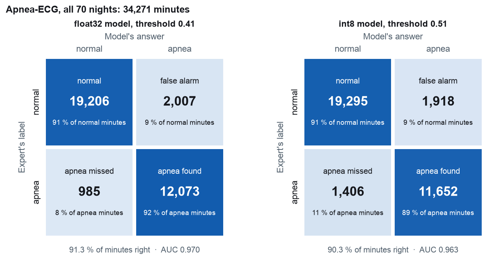
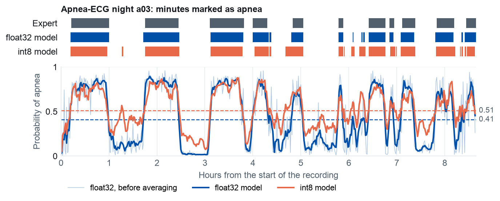
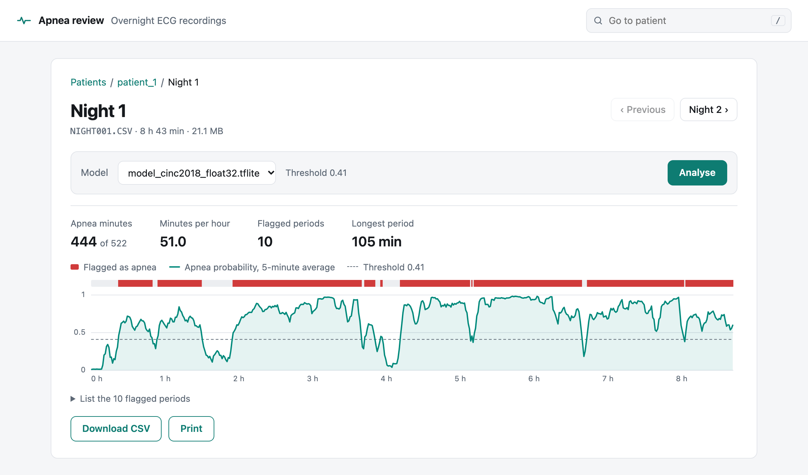
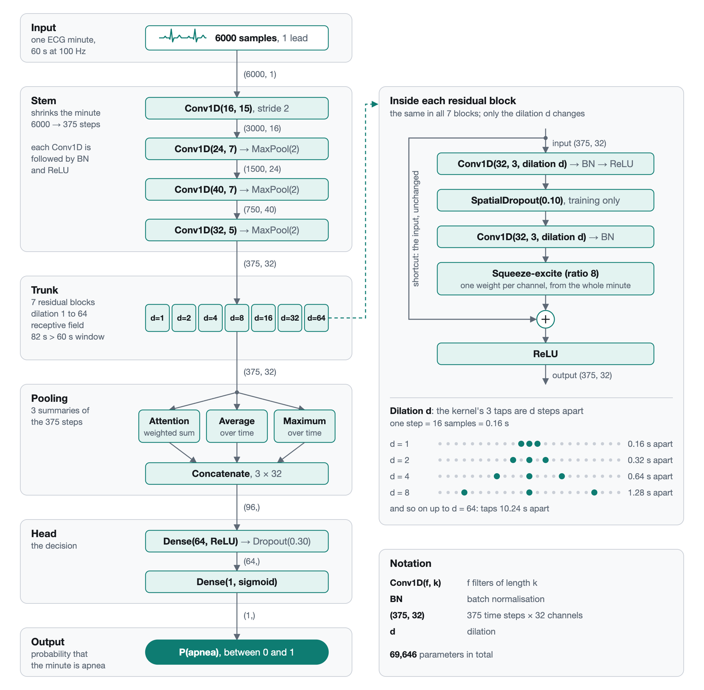

# SLEEP_APNEA_DETECTION_CNN

Sleep apnea detection from a single-lead ECG using a 1D convolutional neural network.

This project is part of my internship within the Moroccan Society of Digital Health, carried out in partnership with medical professionals and the industrial company Promamec.

Sleep apnea is a disorder in which breathing stops or becomes shallow many times during the night. The reference test, an overnight polysomnography in a sleep laboratory, records many signals and is expensive and hard to access. This project explores a simpler path: a single ECG lead, and a neural network that marks each minute of the night as apnea or normal, for a doctor to review. The model is small enough for a microcontroller meant for an ESP32-S3 with an AD8232 ECG front end, one prediction per minute.

The project has two parts:

- **Training**: one notebook, [training/model.ipynb](training/model.ipynb), from downloading the data to scoring the TFLite models on the test set. A second one, [training/inference.ipynb](training/inference.ipynb), scores the service's CinC 2018 models on every night of the Apnea-ECG database.
- **Inference service**: a Docker service with a web interface that runs those models on overnight recordings, patient by patient. See [INTERFACE.md](INTERFACE.md).

---

## Overview

| | |
|---|---|
| **Dataset** | [CinC Challenge 2018](https://physionet.org/content/challenge-2018/1.0.0/) (PhysioNet, Ghassemi et al., 2018): 994 nights from 994 people, Massachusetts General Hospital; training, validation and test |
| **Signal** | Single-lead ECG of full-night recordings, recorded at 200 Hz and resampled to 100 Hz |
| **Input** | One 60 s window = 6000 raw samples, z-scored per window |
| **Label** | One per minute: 1 if the minute holds an apnea or a hypopnea, 0 if not |
| **Model** | Dilated residual 1D CNN: 4-layer stem, 7 residual blocks (dilations 1 to 64), 69,646 parameters |
| **Loss** | Binary cross-entropy |
| **Framework** | TensorFlow 2.20 (Keras 3) |
| **Review interface** | FastAPI + React, with a PostgreSQL database, in Docker ([INTERFACE.md](INTERFACE.md)) |

---

## Results

From the run of the notebook's pipeline in Google Colab (T4 GPU) whose TFLite files the inference service runs as `model_cinc2018_*.tflite`, on the 99 test people (43,726 minutes, 23.1 % apnea), who play no part in training or in choosing the threshold:

| Model | Threshold | AUC | Accuracy | Sensitivity | Specificity | Precision |
|---|---|---|---|---|---|---|
| Keras (`model.keras`) | 0.41 | 0.861 | 84.2 % | 0.537 | 0.934 | 0.709 |

Training ran 22 epochs; the saved model is epoch 10, the best (validation AUC 0.860).

On recordings from another hospital, [training/inference.ipynb](training/inference.ipynb) scores the service's two files on the 70 nights of the [Apnea-ECG](https://physionet.org/content/apnea-ecg/1.0.0/) database, which the training notebook never uses, at the thresholds chosen on the validation people (`.env`: 0.41 for float32, 0.51 for int8):

| Model | Nights | AUC | Accuracy | Sensitivity | Specificity |
|---|---|---|---|---|---|
| float32 | all 70 | 0.970 | 91.3 % | 0.925 | 0.905 |
| int8 | all 70 | 0.963 | 90.3 % | 0.892 | 0.910 |



One of those nights, minute by minute: a03
Top: the minutes marked as apnea. Bottom: each file's probability after the 5-minute average, and its threshold.



---

## Data split

The split is **by person, never by minute**: one person appears in one set only. CinC 2018's 994 labelled nights come from 994 different people, shuffled with seed 42:

| Split | Nights | Minutes | Apnea |
|---|---|---|---|
| `train` | 796 CinC 2018 people | 347,738 | 23.1 % |
| `val` | 99 CinC 2018 people | 42,870 | 24.1 % |
| `test` | 99 CinC 2018 people | 43,726 | 23.1 % |

Only the minutes inside CinC's scored period (from the first to the last sleep-stage label) are used. CinC's official test half has no public labels, are not used.

---

## Repository layout

```
ENSAM_APNEA_CNN/
├── training/
│   ├── model.ipynb          # training: data, model, training, conversion, test
│   └── inference.ipynb      # the service's CinC 2018 models on all 70 Apnea-ECG nights
├── data/                    # git-ignored
│   ├── cinc2018/            # CinC's list of nights; each night's files while they are read
│   ├── nights/              # one .npz per night: ECG in mV and minute labels, ~20 GB
│   ├── processed/           # X_, y_ and night_ arrays for train, val and test, ~5 GB, and apnea-ecg
│   └── apnea-ecg/           # Apnea-ECG records for make demo, make eval and inference.ipynb
├── results/                 # written by the notebooks
│   ├── model.keras          # trained Keras model, best validation epoch
│   ├── model_float32.tflite # the same model unquantised, float32 throughout
│   ├── model_int8.tflite    # unquantised int8 model
├── services/
│   ├── inference/           # the inference service, see INTERFACE.md
│   │   ├── source/          # the Python code:
│   │   │   ├── app.py           # HTTP API
│   │   │   ├── pipeline.py      # preprocessing and model wrapper
│   │   │   ├── patients.py      # rules for patient names and night files
│   │   │   └── db.py, store.py  # database tables, and reading and writing them
│   │   ├── web/             # web interface (React + TypeScript)
│   │   ├── demo/apnea_ecg.py  # make demo: demo patients from Apnea-ECG's 35 test recordings
│   │   ├── demo/evaluate.py   # make eval: the cinc2018 models scored on those patients
│   │   ├── data/models/     # .tflite models the service runs
│   │   └── Dockerfile, requirements.txt
│   └── database/            # the PostgreSQL database, see DATABASE.md
│       ├── Dockerfile       # its image (PostgreSQL 18)
│       ├── setup/setup.sh   # starts PostgreSQL with the settings from .env
│       └── data/            # its files: patients, recordings, results (git-ignored)
├── requirements.txt         # Python packages of the training notebook
├── docker-compose.yml       # runs the inference service and its database
├── Makefile                 # make up, make rebuild, make logs, make shell...
├── .env.example             # service settings; copy to .env
├── INTERFACE.md             # inference service guide
├── DATABASE.md              # the database: tables, looking at the data, backups
└── docs/
    ├── figures/             # README.md's result figures
    ├── screenshots/         # screenshots used by README.md, INTERFACE.md and DATABASE.md
    └── diagrams/            # diagrams used by README.md and DATABASE.md
```

---

## Setup: training notebook

Python **3.11** and the packages in [requirements.txt](requirements.txt) (the versions the notebook was run with):

```bash
python3.11 -m venv .venv
source .venv/bin/activate
pip install -r requirements.txt
```

Then open [training/model.ipynb](training/model.ipynb), select the `.venv` kernel, and run all cells. The notebook finds the project folder on its own, whether the kernel starts in `training/` or at the root.

A first run downloads about 130 GB from PhysioNet (each night's ECG comes in one file with its 12 other channels) and keeps about 26 GB; downloaded files are deleted once read. The download takes 1 to 2 hours at 20 MB/s. The reference run trained on a T4 GPU in Google Colab, where early stopping ended training after 22 epochs. Later runs skip what is already done.

---

## Setup: inference service

Docker Desktop and GNU Make, nothing else:

```bash
cp .env.example .env    # then replace change-me with a password, in both lines
make up
```

Then open **http://localhost:8000**: a list of patients, each with their recorded nights. Pick a model and analyse a night, or all of a patient's nights at once, to see the apnea minutes per hour, the flagged periods and a minute-by-minute chart.



Patients, recordings and results are all kept in the database. Add recordings, one `.csv` file per night (one ECG sample per line, in mV, at 100 Hz), with **Create patient** and **Upload nights** in the interface.

To try it without recordings of your own, `make demo` adds three patients with the 35 test recordings of the Apnea-ECG database, and `make eval` scores the CinC 2018 models on them.

The full documentation is in [INTERFACE.md](INTERFACE.md).

---

## The notebook, section by section

### Setup

Imports, whether to keep CinC's downloaded files (`KEEP_RAW`), folders (created if missing), output file paths, and a fixed seed (42) for Python, NumPy and TensorFlow, so a rerun on the same machine and library versions produces the same model.

### Dataset

Runs only what is missing. For every night:

1. **Download** its three files from PhysioNet's copy on Amazon S3 (physionet.org as a fallback), each checked against PhysioNet's SHA-256 list: `.hea` header, `.mat` samples (13 channels, the ECG is channel 12, 200 Hz), `.arousal` annotations.
2. **Labels**, one per minute. The expert marked each apnea and hypopnea with a start and an end; a minute overlapping one of them is labelled 1. Minutes outside the scored period are left out.
3. **Save** the ECG in mV and the labels to `data/nights/<night>.npz`, then delete the downloaded files.

### Windows

Every night goes through the preprocessing of the inference service:

- resampling from 200 Hz to 100 Hz (polyphase, with its own anti-aliasing filter); `data/nights/` keeps the 200 Hz signal;
- a 4th-order Butterworth band-pass (0.5 to 40 Hz) removes baseline wander and high-frequency noise, and a 50 Hz notch removes mains interference. Both are zero-phase (forward then backward), so the heartbeats do not move in time;
- missing samples are replaced by the median, and the signal is clipped to ±5 mV;
- each labelled minute becomes one 6000-sample row, z-scored against its own mean and standard deviation. This removes the patient-specific amplitude and keeps the shape of the minute.

A minute is dropped only when the expert did not score it, never for signal quality. Output in `data/processed/`, float16, read from disk during training rather than loaded into memory:

| File | Shape |
|---|---|
| `X_<split>.npy` | (minutes, 6000) |
| `y_<split>.npy` | (minutes,): 1 apnea, 0 normal |
| `night_<split>.npy`, `nights_<split>.json` | (minutes,): the night each minute comes from |

### Model



The stem shrinks the minute to 375 timesteps; the dilated blocks then widen the receptive field to **8225 samples (82.2 s)**. `build_model()` asserts that this covers the 60 s window, so a change to the stem or the dilations that breaks the coverage fails at build time.

### Training

Adam (learning rate 1e-3), binary cross-entropy, batch size 64, up to 70 epochs. The training set is reshuffled every epoch, and each window is turned upside down (multiplied by -1) with probability 0.5 (`FLIP`), since the sign of a recorded ECG depends on the electrode placement. Two callbacks watch the validation AUC:

- `EarlyStopping(patience=12)`: stops after 12 epochs without improvement;
- `ReduceLROnPlateau(factor=0.5, patience=6)`: halves the learning rate after 6 epochs without improvement.

Three more keep the run on disk: the last finished epoch (`results/backup/`), the best epoch so far (`results/best.keras`) and one line per epoch (`results/history.csv`). The Save cell loads `best.keras`, so the saved model is the best epoch, not the last one. An interrupted run continues from its last finished epoch when the Training cell is run again, and both callbacks above pick up their count from `history.csv`: Keras's own versions start again from zero after a resume.

Saved to `results/`: `model.keras`, `history.json`, and `training_curves.png` (loss, AUC, validation precision and recall, validation ROC curve). Training again overwrites these files.

### TensorFlow Lite conversion

Converts `model.keras` into two TFLite files, both with a **fixed input shape** `(1, 6000, 1)` (a microcontroller allocates all its memory up front):

- `model_int8.tflite` (134.8 KB), **full int8**: weights, activations, input and output. The int8 ranges are calibrated on 500 real training windows;
- `model_float32.tflite` (306.1 KB), **unquantised**: float32 throughout, so it computes what `model.keras` computes. It takes the z-scored window and returns the probability directly.

### Test set

Scores `model.keras`, `model_float32.tflite` and `model_int8.tflite` on the 99 test people. For each model:

1. predict on the validation people and **smooth** the probabilities with a 5-minute moving average, within each night separately (apnea comes in runs of several minutes, while the model scores each minute alone);
2. choose the threshold that maximises validation accuracy.
3. apply that threshold **once** to the smoothed test predictions, and report AUC, accuracy, sensitivity, specificity, precision and the confusion matrix, also saved to `results/test_results.json`.

---

## The Apnea-ECG notebook

[training/inference.ipynb](training/inference.ipynb) runs the two models the service lists, `model_cinc2018_float32.tflite` and `model_cinc2018_int8.tflite`, on all 70 nights of [Apnea-ECG](https://physionet.org/content/apnea-ecg/1.0.0/) (a01 to a20, b01 to b05, c01 to c10, x01 to x35), which no model was trained on. It uses the same `.venv` as the training notebook.

1. **Dataset**: downloads what `data/apnea-ecg/` is missing, then builds the set once with the service's preprocessing, keeping the minutes the expert labelled: `X_apnea-ecg.npy` (34,271 minutes, 6000 samples each, float16), `y_apnea-ecg.npy`, `night_apnea-ecg.npy` and `nights_apnea-ecg.json` in `data/processed/`.
2. **Models**: runs both `.tflite` files one window at a time, as the service does. The thresholds and the smoothing are read from `MODEL_THRESHOLDS` and `SMOOTH_WINDOW` in `.env` (`.env.example` when there is no `.env`), so the decisions are the service's.
3. **Scores**: TN, FP, FN, TP, accuracy, sensitivity, specificity, precision, F1 and AUC, for all nights, x01 to x35 (the nights `make eval` scores), a01 to c10, and apnea, borderline and control nights. Saved, every night's included, to `results/inference/scores.json`.
4. **Figures**, saved to `results/inference/`: confusion matrices, ROC and precision-recall curves, accuracy, sensitivity and specificity against the threshold, and one night in detail (`EXAMPLE_NIGHT`).
